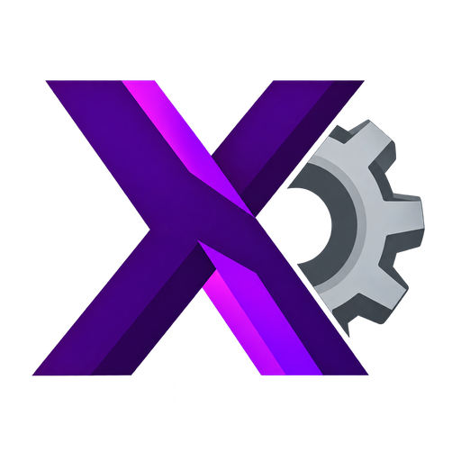

<div align="center">
  
  <h1>XEngine</h1>
  <p><strong>A lightweight, cross-platform 2D game engine built with C++20 and SDL2.</strong></p>
  <p><em>Build 2D games in C++. Understand the engine. Own your code.</em></p>
  <p>
    <a href="https://en.cppreference.com/w/cpp/20"></a>
    <a href="https://www.libsdl.org/"></a>
    
    
    
  </p>
  <p>
    <a href="#quick-start">Get started</a> ·
    <a href="#features">Features</a> ·
    <a href="#documentation">Documentation</a> ·
    <a href="#benchmarking-and-profiling">Benchmarks</a> ·
    <a href="#migrating-from-xengine-legacy">Legacy migration</a>
  </p>
</div>

---

## Why XEngine?

XEngine is a **source-driven** 2D engine with a familiar **Scene → GameObject → Component / Behaviour** model. It takes inspiration from engines such as Unity without requiring a proprietary editor or scripting runtime: games and engine systems are regular, readable C++.

The project includes a portable build tool, a ready-to-use game template and an actual SDL2 benchmark game. The engine targets native **Windows** and **Linux** development, with optional cross-compilation when the corresponding target toolchain and SDL2 SDK are available.

> **Scope:** XEngine uses SDL2, SDL2_image, SDL2_mixer and SDL2_ttf. Android, macOS, iOS and web are **not supported build targets** at present. Multithreading is optional; it does not promise faster rendering for every scene.

## Features

| System | What you get |
|:--|:--|
| **Scenes & components** | GameObjects, hierarchical transforms, reusable Behaviours and safe queued scene/object operations |
| **2D rendering** | Sprites, textures, animations, rotation (including X/Y pseudo-3D projection), camera, parallax, culling and UI |
| **Physics & collision** | RigidBody2D, box/circle colliders, triggers, collision events and fixed-timestep simulation |
| **Input, audio & assets** | Keyboard/mouse, cached textures and fonts, sound effects, music and immediate-mode UI |
| **Performance tools** | Optional collision workers, render-command preparation workers, adaptive collision broadphase, CSV profiling and F3/F4 overlays |
| **Build & distribution** | Windows/Linux native builds, optional cross-build SDK tooling and packaged Release archives |

For architecture, rendering, threading and physics details, read [Architecture](docs/ARCHITECTURE.md), [Multithreading & profiling](docs/MULTITHREADING_AND_PROFILING.md) and the [Developer Guide](docs/DEVELOPER_GUIDE.md).

## Quick start

Clone the repository and install the **host compiler, Python 3.10+ and SDL2 development libraries**. The commands below create a new game rather than depending on private sample games.

<details open>
<summary><strong>Windows 10/11 · MSYS2 UCRT64</strong></summary>

Install [MSYS2 UCRT64](https://www.msys2.org/) and follow the [Windows dependency guide](docs/DEVELOPER_GUIDE.md#windows-1011-x86_64--msys2-ucrt64). Ensure `g++` and `pkg-config` resolve to your UCRT64 installation, then run in a Windows terminal from the repository root:

```bat
check_dependencies.bat
new_project.bat "My Game"
cd "games\My Game"
build.bat --run
```

</details>

<details>
<summary><strong>Linux · Ubuntu / Debian</strong></summary>

Install GCC, Python and the SDL2 packages using the [Linux dependency guide](docs/DEVELOPER_GUIDE.md#linux-x86_64--ubuntu--debian). Then, from the repository root:

```bash
./check_dependencies.sh
./new_project.sh "My Game"
cd "games/My Game"
./build.sh --run
```

</details>

To build a distributable version, run `build.bat --config Release` (Windows) or `./build.sh --config Release` (Linux) inside the game directory. See the [Release distribution guide](docs/DEVELOPER_GUIDE.md#release-distribution) for packaging, icons, assets and runtime dependencies.

## Project structure

```text
XEngine/
├── engine/
│   ├── include/              # Public C++20 engine API
│   └── src/                  # Engine implementation
├── games/
│   └── XEngine Benchmark/    # Public, reproducible benchmark game
├── tools/
│   ├── templates/BlankGame/ # Starting point for new games
│   ├── new_project.py       # Create a game
│   ├── build.py             # Native and cross-platform build driver
│   └── sync_engine_configs.py
├── docs/                     # Architecture and advanced guides
├── tests/                    # Regression tests
└── README.md
```

A generated game uses `src/main.cpp` for startup, `src/InitCallback.hpp` for asset loading and scene registration, and `assets/scenes/`, `assets/gameobjects/` and `assets/scripts/` for game code. Build settings live in `config.json`; runtime settings live in `assets/config/engine.json`.

### Runtime configuration

The canonical runtime schema lives in [`BlankGame/assets/config/engine.json`](tools/templates/BlankGame/assets/config/engine.json). When the engine's configuration changes, the template and synchronization manifest must be updated together.

```bash
python tools/sync_engine_configs.py --check  # Preview changes
python tools/sync_engine_configs.py          # Apply without replacing custom values
```

See [Engine configuration migration](docs/ENGINE_CONFIG_MIGRATION.md). The renderer's `parallelMinCommands` currently defaults to **384**; this is a compatibility default, **not an experimentally established optimal threshold**.

### Which games are published?

The **XEngine Benchmark** is included in Git by default. Other games are excluded unless their root contains `games/<Game Name>/.gitkeep`. Markers inside `assets/` do **not** opt a game in. The new-project generator deliberately skips `.gitkeep` markers.

To reconcile rules and stage opted-in games:

```bash
python tools/sync_game_gitignore.py --stage
```

An optional `pre-commit` hook automates this step after it has been enabled with `git config --local core.hooksPath .githooks`. **It stages all changes in included games**, so review `git diff --cached` before committing. See [Game Git tracking](docs/GAME_GIT_TRACKING.md).

## Platforms & builds

| Host | Target | Status |
|:--|:--|:--|
| Windows · MSYS2 UCRT64 | Windows x86_64 | Native build supported |
| Linux · GCC | Linux x86_64 | Native build supported |
| Linux · MinGW-w64 | Windows x86_64 | Cross-build and packaging demonstrated; verify on Windows |
| Windows · Clang/LLD | Linux x86_64 | Cross-build tooling provided; end-to-end validation required |

**Cross-compilation requires the target SDK** (including the target SDL2 libraries). XEngine offers optional setup helpers; there is no requirement to use Visual Studio, CMake, Make or Ninja.

[Cross-compilation guide](docs/CROSS_COMPILATION.md) · [Dependency and packaging reference](docs/DEVELOPER_GUIDE.md) · [Configure a custom build](docs/DEVELOPER_GUIDE.md#build-configuration-configjson)

**Optional cross-SDK setup** (run from the repository root after installing the host compiler):

```powershell
install_cross_sdk.bat --target linux  # Windows → Linux
```

```bash
./install_cross_sdk.sh --target windows  # Linux → Windows
```

Use `--sdk-dir` to choose a custom SDK directory. For a manual alternative, see the [cross-compilation reference](docs/CROSS_COMPILATION.md).

## Benchmarking and profiling

`games/XEngine Benchmark/` contains an SDL2 game for repeatable comparisons of collisions, threading and render workloads (including rotation, tint, culling and composite scenes). It is checked into Git; the results generated locally are ignored.

For an interactive overview, toggle the **F3** debug profiler and use **F4** to change pages. When `Engine.profileCsv` is enabled, frame and subsystem timings can be exported for analysis.

```bash
python tools/compare_profiles.py --game "XEngine Benchmark"
```

The parallel collision path has shown measurable advantages in high-contact workloads. **Render preparation parallelism is workload-dependent**: existing measurements do not establish a universal speedup or threshold. See the [benchmark game guide](docs/BENCHMARK_GAME.md), [render calibration](docs/RENDER_THRESHOLD_CALIBRATION.md) and [adaptive broadphase](docs/ADAPTIVE_BROADPHASE.md).

## Migrating from XEngine-Legacy

[XEngine-Legacy](https://github.com/the-33/XEngine-Legacy) is the **earlier Visual Studio/MSVC-based engine**, not an earlier build of this repository. Its projects use a different source layout, startup procedure and configuration paths.

A **general-purpose Legacy → modern XEngine migrator is being evaluated, not yet implemented**. The proposed tool would generate a modern game project, copy assets, translate known configuration keys and produce a report of C++ code requiring manual attention. It should never silently rewrite unknown C++ syntax or modify the original project.

Read the [Legacy migration feasibility and proposed design](docs/LEGACY_MIGRATION_PLAN.md).

## Documentation

| Guide | Subject |
|:--|:--|
| [Architecture](docs/ARCHITECTURE.md) | Engine systems, scenes and lifecycle |
| [Developer guide](docs/DEVELOPER_GUIDE.md) | Complete installation, building, packaging and troubleshooting reference |
| [Cross-compilation](docs/CROSS_COMPILATION.md) | Windows/Linux SDKs, cross builds and verification |
| [Multithreading and profiling](docs/MULTITHREADING_AND_PROFILING.md) | Worker scheduling, profiler and tradeoffs |
| [Benchmark game](docs/BENCHMARK_GAME.md) | Reproducible game-integrated performance tests |
| [Render threshold calibration](docs/RENDER_THRESHOLD_CALIBRATION.md) | Deterministic render scenarios and equivalence checking |
| [Engine config synchronization](docs/ENGINE_CONFIG_MIGRATION.md) | Canonical settings, backups and safe updates |
| [Game Git tracking](docs/GAME_GIT_TRACKING.md) | How to include or exclude your games |
| [Legacy migration plan](docs/LEGACY_MIGRATION_PLAN.md) | Scope and limits of a future Legacy migrator |

## Contributing & testing

XEngine is an evolving C++20 engine. Changes should preserve cross-platform behavior and be accompanied by reproducible tests, particularly for scene lifetime, collisions, rendering and packaging.

```bash
python -m unittest discover -s tests -v
```

Tests do not replace compiling and running a real SDL2 game on the intended host and target platforms. The C++ engine is portable, but toolchains, binaries and library dependencies are platform-specific.

---

<div align="center">
  <sub>Made with C++20 and SDL2 · <a href="https://github.com/the-33/XEngine-Legacy">From XEngine-Legacy to XEngine</a></sub>
</div>
